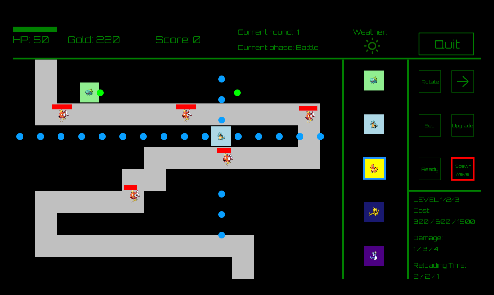
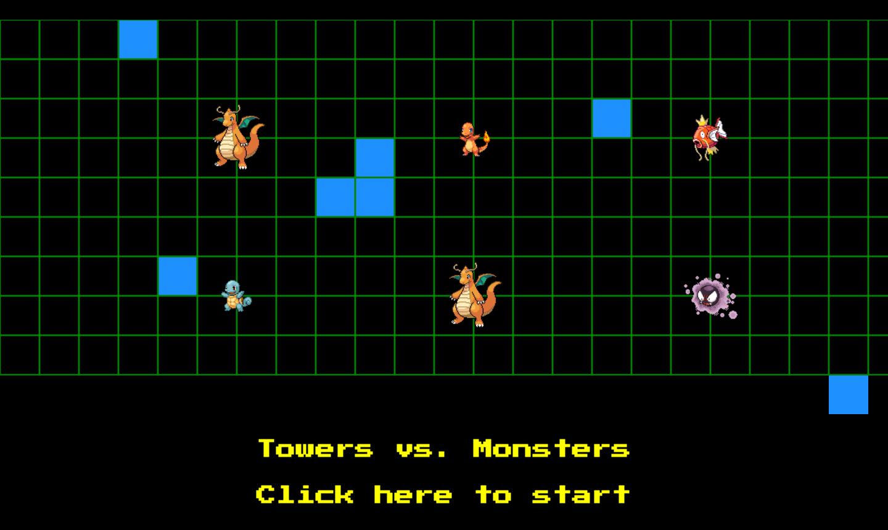
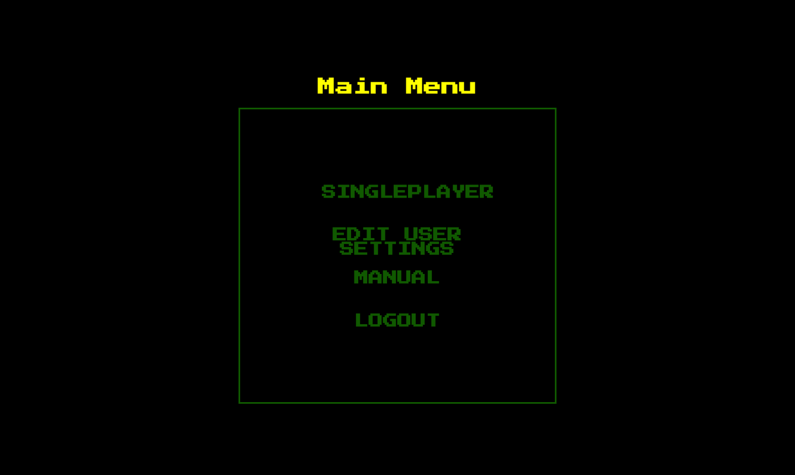
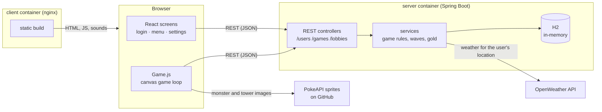

<div align="center">

# Towers vs. Monsters

**A browser tower defense game with a React canvas client and a Spring Boot REST server**


[Quick start](#quick-start) · [How to play](docs/gameplay.md) · [API](docs/api.md) · [Documentation](#documentation)



</div>

Build towers next to the path, start a wave and stop the monsters before they reach the end. Every monster that gets
through costs health points; every monster you defeat earns gold for more and stronger towers. The weather at your
location, fetched from OpenWeather, is shown in the game.

The game was built by a student team in the [Software Engineering Lab (SoPra)](#authors) at the University of Zurich in
spring 2021.

## Features

- 🗼 Five tower types (plant, water, fire, psychic, dragon) with three upgrade levels, and selling for 70 % of the price
- 👾 Seven monster types; the server generates each wave, with boss waves every five rounds from round 10
- 🎯 Canvas game loop in the browser: movement along the path, projectiles and collision detection
- 🌦️ Weather at the player's location via the OpenWeather API
- 👤 Accounts with login, logout and profile settings (username, password, location)
- 🔊 Retro sound effects and an 8-bit arrangement of the Atari title "3D Galax" as title music
- 🐳 One `docker compose up` starts client and server

> [!NOTE]
> This is a student project from 2021 and is not developed further. The dependencies (React 17, Create React App 4,
> Java 15, Spring Boot 2.4, Gradle 6.8) are pinned to that time. The Docker setup provides the matching Java and Node
> versions, so you do not need to install them.

> [!TIP]
> The branch [`original`](../../tree/original) holds the code exactly as it was at the end of the course. `main` adds
> only what is needed to run and document it; see the [commit history](../../commits/main).

## Contents

- [Screenshots](#screenshots)
- [Tech stack](#tech-stack)
- [Architecture](#architecture)
- [Repository structure](#repository-structure)
- [Quick start](#quick-start)
- [Services and ports](#services-and-ports)
- [Configuration](#configuration)
- [API](#api)
- [Development](#development)
- [Documentation](#documentation)
- [Known issues](#known-issues)
- [Authors](#authors)
- [Acknowledgements](#acknowledgements)
- [License](#license)

## Screenshots

| Title screen | Main menu |
|---|---|
|  |  |

## Tech stack

| Area | Technologies |
|---|---|
| Client |      |
| Server |      |
| Database |  |
| External API |  |
| Infrastructure |   |

## Architecture



The browser runs the game loop: it moves monsters, fires projectiles and detects hits. The server owns accounts,
boards and gold: it checks and charges tower purchases, upgrades and sales, and it decides which monsters each wave
contains. After each wave the client reports gold and health back. See [docs/architecture.md](docs/architecture.md).

| Part | Where |
|---|---|
| Game loop, rendering, shop | [client/src/components/game/Game.js](client/src/components/game/Game.js) |
| Screens (title, login, menu, settings) | [client/src/components](client/src/components) |
| REST endpoints | [server/src/main/java/ch/uzh/ifi/hase/soprafs21/controller](server/src/main/java/ch/uzh/ifi/hase/soprafs21/controller) |
| Game rules, prices, waves | [server/src/main/java/ch/uzh/ifi/hase/soprafs21/service/GameService.java](server/src/main/java/ch/uzh/ifi/hase/soprafs21/service/GameService.java) |

## Repository structure

| Path | Content |
|---|---|
| [client/](client) | React client (Create React App), Dockerfile and nginx config |
| [server/](server) | Spring Boot server (Gradle), Dockerfile |
| [docs/](docs) | Guides and screenshots |
| [docker-compose.yml](docker-compose.yml) | Starts client and server |
| [.env.example](.env.example) | Example configuration for Docker Compose |
| [TODO.md](TODO.md) | Open tasks |

The two parts were separate repositories in 2021
([td-client](https://github.com/sopra-fs21-group-10/td-client), [td-server](https://github.com/sopra-fs21-group-10/td-server)).
This repository merges both with their full history.

## Quick start

Requirements: [Docker](https://docs.docker.com/get-docker/) with Docker Compose. The game needs a window of at least
about 1400 × 800 pixels.

1. Optional: create a configuration file and add your OpenWeather key. Without a key the game uses clear weather.

   ```bash
   cp .env.example .env
   ```

2. Build and start client and server:

   ```bash
   docker compose up --build
   ```

3. Open [http://localhost:3000](http://localhost:3000), click the title screen, create an account and choose
   **Singleplayer → Start Game**.

4. Stop everything with <kbd>Ctrl</kbd>+<kbd>C</kbd>, or from another terminal:

   ```bash
   docker compose down
   ```

The server keeps everything in memory, so accounts and games are gone after a restart.

## Services and ports

| Service | URL | Description |
|---|---|---|
| client | [http://localhost:3000](http://localhost:3000) | Game (nginx serving the production build) |
| server | [http://localhost:8080](http://localhost:8080) | REST API; `GET /` returns `The application is running.` |

## Configuration

Docker Compose reads these variables from `.env` or the environment:

| Variable | Default | Meaning |
|---|---|---|
| `WEATHER_KEY` | empty | [OpenWeather](https://openweathermap.org/api) API key. Empty: clear weather, locations are not checked |
| `SERVER_PORT` | `8080` | Host port of the server; also baked into the client build as the API URL |
| `CLIENT_PORT` | `3000` | Host port of the client |

Outside Docker the server reads the key from the environment variable `WeatherKey`, and the client reads the API URL
from `REACT_APP_API_URL` at build time (default `http://localhost:8080`).

## API

The server offers a small REST API for users, games and (unused) multiplayer lobbies. Most game endpoints take the
user's token in the path, for example `POST /games/towers/{token}`. The full list with request and response bodies is
in [docs/api.md](docs/api.md).

## Development

| Task | Command / guide |
|---|---|
| Run client and server | `docker compose up --build` |
| Run server tests (Java 15 in Docker) | see [docs/development.md](docs/development.md#server) |
| Run client tests (Node 14 in Docker) | see [docs/development.md](docs/development.md#client) |
| Run without Docker | [docs/development.md](docs/development.md#without-docker) |
| Where to change what | [docs/development.md](docs/development.md#where-to-change-what) |

## Documentation

| Guide | Content |
|---|---|
| [docs/gameplay.md](docs/gameplay.md) | How to play: controls, towers, monsters, waves |
| [docs/architecture.md](docs/architecture.md) | Client and server, game flow, data model |
| [docs/api.md](docs/api.md) | REST endpoints |
| [docs/development.md](docs/development.md) | Build, test, run without Docker, code layout |

## Known issues

- **Security is at student-project level.** Passwords are stored in plain text, tokens travel in URL paths, and
  the server trusts the gold and health values that the client reports after each wave. Do not deploy it as is.
- **No persistence.** The H2 database lives in memory.
- **Multiplayer was never finished.** The lobby screens (`/multiplayer`, `/lobby`, …) and the `/lobbies` and
  `/games/minions` endpoints are left over from the original plan; the menu does not link to them.
- **Fixed canvas size.** The game canvas is 1366 × 770 pixels and does not scale; on small screens it is cut off.
- **Images need internet access.** Tower, monster and title screen images are loaded at runtime from the
  [PokeAPI sprites](https://github.com/PokeAPI/sprites) repository on GitHub.
- **Old CI files.** `client/.github` and `server/.github` contain the 2021 workflows for SonarCloud and Heroku.
  GitHub does not run them from subfolders, and the Heroku apps no longer exist.
- Unknown game or user IDs make `GET /games/{gameId}` and `POST /games` return `500` instead of `404`
  ([details](docs/api.md#singleplayer-game)).
- The OpenWeather request uses the old `data/2.5/weather` endpoint over plain HTTP. It is not tested with a current
  key.

## Authors

Created by group 10 in the course *Softwarepraktikum* (SoPra, software engineering lab) at the
[University of Zurich](https://www.uzh.ch), spring semester 2021.

| Member | Main contributions |
|---|---|
| [Nicolas Huber](https://github.com/HuberNicolas) | Client game: canvas game loop, rendering, towers, monsters, projectiles and collision detection, shop, upgrade and sell ([Game.js](client/src/components/game/Game.js)); title, login, registration, menu and settings screens; manual; title music arrangement; CI and deployment |
| [Nicolas Blumer](https://github.com/Thahit) | Server: game, board and user logic, REST API, wave generation, weather integration, tests; parts of the client game and multiplayer |
| [Michael Vuong](https://github.com/Seouless29) | Client: multiplayer lobby screens, UI |
| [Mauro](https://github.com/maurohirt) | Server: lobbies (until milestone 3) |
| [Matej Gurica](https://github.com/bzns) | Client: first title page and user settings (until milestone 3) |

Louis Huber and Omar Abo Hamida were part of the group until the first assessment.

## Acknowledgements

- Supervision: [Marion Dübendorfer](https://github.com/demaerl), [Roy Rutishauser](https://github.com/royru) and
  Prof. Thomas Fritz ([HASEL](https://www.ifi.uzh.ch/en/hasel.html), University of Zurich).
- The code started from the SoPra FS21 client and server templates (Roy Rutishauser, Lucas Pelloni, Moritz Eck,
  Alex Scheitlin and others).
- Sound effects: [The Essential Retro Video Game Sound Effects Collection](https://opengameart.org/content/512-sound-effects-8-bit-style)
  by Juhani Junkala, [CC0 1.0](https://creativecommons.org/publicdomain/zero/1.0/)
  ([client/src/assets/sounds](client/src/assets/sounds)).
- Weather icons: [Feather](https://feathericons.com/) by Cole Bemis, [MIT License](https://github.com/feathericons/feather/blob/main/LICENSE)
  ([client/src/assets/img](client/src/assets/img)).
- Title music: arrangement by Nicolas Huber, made with [BeepBox](https://www.beepbox.co/), of the soundtrack of
  *3D Galax* (Atari, 1987) by [Ben Daglish](https://en.wikipedia.org/wiki/Ben_Daglish), based on a MIDI transcription
  by the YouTuber ZdrytchX ([client/src/assets/music](client/src/assets/music)).
- Monster and tower images: sprites from the [PokeAPI sprites](https://github.com/PokeAPI/sprites) repository, loaded
  at runtime and not part of this repository. Pokémon and its characters are © Nintendo, Creatures Inc. and GAME FREAK
  inc. This is a non-commercial student project without affiliation.
- Weather data: [OpenWeather](https://openweathermap.org/).
- Fonts Press Start 2P and Orbitron are loaded from [Google Fonts](https://fonts.google.com/)
  ([SIL Open Font License](https://openfontlicense.org/)).

## License

The code is licensed under the [MIT License](LICENSE), © 2021 sopra-fs21-group-10 (the authors above) and
© 2026 Nicolas Huber for later changes.

The MIT License does not cover third-party material: the sound effects (CC0), the Feather icons (MIT, © Cole Bemis),
the title music (an arrangement of a composition by Ben Daglish), and the Pokémon sprites and names, which remain the
property of their owners.
