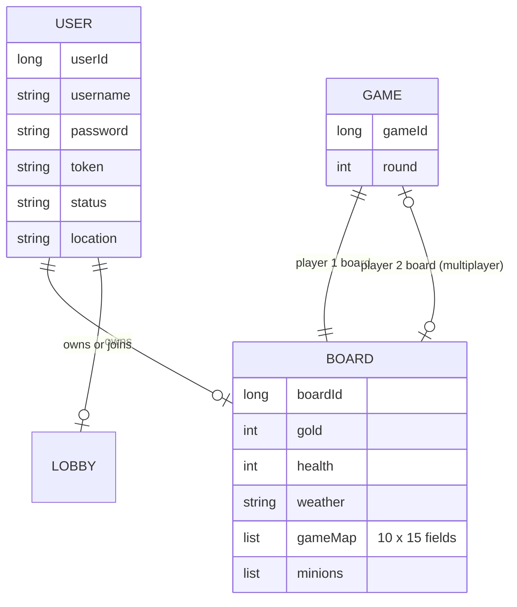
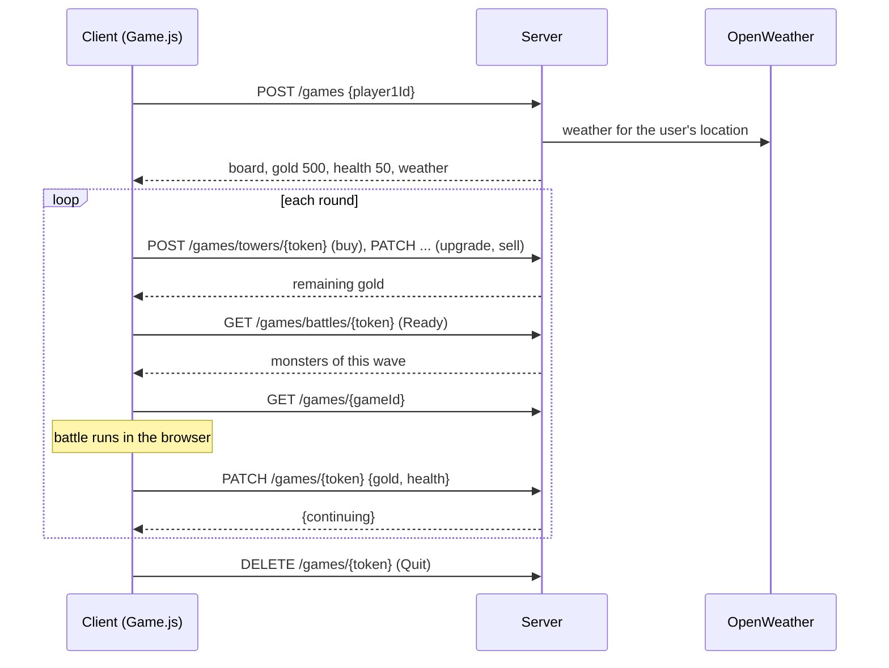

# Architecture

The game has two parts: a React single-page app that runs the game loop on an HTML canvas, and a Spring Boot server
that stores users and boards and enforces prices. They talk over REST with JSON.

## Client

| Path | Content |
|---|---|
| [src/components/game/Game.js](../client/src/components/game/Game.js) | The whole game: canvas setup, tower and monster definitions, event listeners, game loop, REST calls |
| [src/components/title](../client/src/components/title) | Title screen with animated sprites and title music |
| [src/components/login](../client/src/components/login), [registration](../client/src/components/registration) | Login and sign-up |
| [src/components/main](../client/src/components/main) | Main menu (singleplayer, settings, manual, logout) |
| [src/components/singleplayer](../client/src/components/singleplayer) | Start screen that creates a game on the server |
| [src/components/userSettings](../client/src/components/userSettings) | Change username, password and location |
| [src/components/multiplayer](../client/src/components/multiplayer), [lobby](../client/src/components/lobby), [hostScreen](../client/src/components/hostScreen), [playerScreen](../client/src/components/playerScreen) | Unfinished multiplayer lobby, not linked from the menu |
| [src/components/shared/routers](../client/src/components/shared/routers) | Routes; [routeProtectors](../client/src/components/shared/routeProtectors) redirect users without a token |
| [src/helpers/api.js](../client/src/helpers/api.js), [getDomain.js](../client/src/helpers/getDomain.js) | Axios instance and API URL |
| [src/assets](../client/src/assets) | Sounds, music, weather icons, manual (PDF) |

The client keeps the session in `localStorage`: `token`, `userId`, `gameId`, and during a game `gold`, `health`,
`board`, `wave` and `weather`.

### Game loop

`Game.js` is a single React class component. In `componentDidMount` it sets up the canvas (1366 × 770 pixels, 64-pixel
tiles) and starts `animate()` with `requestAnimationFrame`. Each frame calls handlers that update and draw one part of
the game:

| Handler | Job |
|---|---|
| `handleGameGrid`, `handlePath` | Draw the board and the path |
| `handleTowers` | Draw towers and let them fire projectiles in their direction |
| `handleProjectiles` | Move projectiles, detect hits with `collision`, apply damage |
| `handleMinions` | Move monsters along the path, pay gold for kills, subtract HP at the end of the path, spawn the next monster |
| `handleShop`, `handleGameStatus` | Draw the shop, buttons, tower information, HP, gold, score, round and weather |
| `handleGame` | End the battle phase and report gold and HP to the server |

Mouse input comes from `mousemove` (stores the position) and `click` (decides by position what was clicked).

## Server

Package `ch.uzh.ifi.hase.soprafs21` in [server/src/main/java](../server/src/main/java/ch/uzh/ifi/hase/soprafs21):

| Package | Content |
|---|---|
| `controller` | `UserController`, `GameController`, `LobbyController`: REST endpoints, see [api.md](api.md) |
| `service` | `UserService` (accounts, login, profile), `GameService` (boards, prices, waves, weather), `LobbyService` |
| `entity` | JPA entities `User`, `Game`, `Board`, `Lobby` |
| `repository` | Spring Data repositories |
| `rest/dto`, `rest/mapper` | Request and response objects, MapStruct mapper |
| `exceptions` | Global exception handler |

### Data model

A board is a 10 × 15 grid (`gameMap`). Each field is empty, `blocked` (the path) or holds the name of a tower such as
`PlantTower1`. The server checks that a field is free, that the player can afford the tower, and updates gold.

### Game flow

## Deployment in 2021

Both parts were deployed to Heroku by GitHub Actions and analysed with SonarCloud. The workflow files are still in
`client/.github` and `server/.github`, but they are inactive. Today the project runs with
[Docker Compose](../docker-compose.yml): the server image builds with Java 15, the client image builds with Node 14 and
serves the result with nginx.
