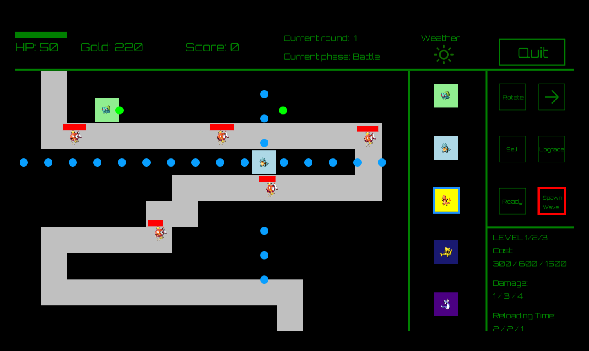

# How to play

You start with **50 HP** and **500 gold**. Monsters walk along the grey path from the top left to the bottom. Each
monster that reaches the end costs HP; each monster your towers defeat pays gold and adds to your score. You win after
**round 30**; the game is over when your HP drop to 0.

## A round

1. **Preparation:** buy, upgrade or sell towers.
2. Click **Ready**. The server sends the monsters for this round and adds 10 % interest to your gold.
3. Click **Spawn Wave**. The monsters start walking; the phase changes to *Battle*.
4. When all monsters are defeated or through, the next preparation phase starts. The client reports your gold and HP to
   the server.

## Controls

| Action | How |
|---|---|
| Buy a tower | Click a tower in the shop, then click a free field next to the path |
| Shooting direction | **Rotate** changes the direction for new towers; the arrow next to it shows it. Towers shoot in a straight line |
| Tower information | Click a tower in the shop; cost, damage and reload time for levels 1/2/3 appear on the right |
| Upgrade | Click **Upgrade**, then the tower on the board |
| Sell | Click **Sell**, then the tower on the board. You get 70 % of its price back |
| Music on/off | Key <kbd>M</kbd> |
| Leave the game | **Quit** (the game is deleted on the server) |

## Towers

Prices per level, as defined in the server
([GameService.java](../server/src/main/java/ch/uzh/ifi/hase/soprafs21/service/GameService.java)). Damage, speed and
reload time are defined in the client ([Game.js](../client/src/components/game/Game.js), `TOWERS`, `TOWERS2`,
`TOWERS3`).

| Tower | Level 1 | Level 2 | Level 3 |
|---|---:|---:|---:|
| Plant | 100 | 200 | 500 |
| Water (shoots in several directions) | 200 | 400 | 1000 |
| Fire | 300 | 600 | 1500 |
| Psychic | 400 | 1000 | 5000 |
| Dragon | 1000 | 2500 | 10000 |

## Monsters

| Monster | Health | Speed | Damage to you |
|---|---:|---:|---:|
| Karpador | 100 | 4 | 1 |
| Nebulak | 175 | 5 | 1 |
| Gengar | 300 | 5 | 2 |
| Garados | 1000 | 3 | 8 |
| Arktos | 7000 | 3 | 15 |
| Zapdos | 2500 | 6 | 10 |
| Lavados | 10000 | 5 | 25 |

The server builds each wave in `GameService.startBattlePhase`: more and stronger monsters each round, with boss waves in
rounds 10, 15, 20, 25 and 30.

## Weather

The weather at the location in your profile (default: Zurich) is fetched when a game starts and shown at the top. It
does not change the game rules. Without an OpenWeather key (see [Configuration](../README.md#configuration)) the
weather is always clear.
